<picture>
  <source media="(prefers-color-scheme: dark)" srcset="assets/banner-dark.svg">
  
</picture>

Computer Science Engineering student at Sri Manakula Vinayagar Engineering College, Puducherry (B.Tech, 2023–2027). I build web applications for real users, and I'm interested in frontend development, Python, and AI/ML.

**Portfolio:** [jeankevin.vercel.app](https://jeankevin.vercel.app) · **LinkedIn:** [Jean Kevin D](https://www.linkedin.com/in/jean-kevin-d-40a205385) · **Email:** jeankevin6220@gmail.com

<picture>
  <source media="(prefers-color-scheme: dark)" srcset="assets/h-projects-dark.svg">
  
</picture>

<a href="https://www.teambullfuelhouse.com"><picture><source media="(prefers-color-scheme: dark)" srcset="assets/card-teambull-dark.svg"></picture></a>
<a href="https://github.com/Jeankevin14/cts-practice-frontend"><picture><source media="(prefers-color-scheme: dark)" srcset="assets/card-proauth-dark.svg"></picture></a>

<a href="https://jeankevin.vercel.app/brainy-blooms/"><picture><source media="(prefers-color-scheme: dark)" srcset="assets/card-tracker-dark.svg"></picture></a>
<a href="https://jeankevin.vercel.app/#work"><picture><source media="(prefers-color-scheme: dark)" srcset="assets/card-assessment-dark.svg"></picture></a>

<picture>
  <source media="(prefers-color-scheme: dark)" srcset="assets/h-in-motion-dark.svg">
  
</picture>

<a href="https://www.teambullfuelhouse.com"><picture><source media="(prefers-color-scheme: dark)" srcset="assets/motion/motion-teambull-dark.svg">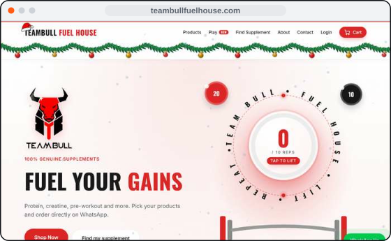</picture></a>
<a href="https://jeankevin.vercel.app"><picture><source media="(prefers-color-scheme: dark)" srcset="assets/motion/motion-portfolio-dark.svg"></picture></a>
<a href="https://github.com/Jeankevin14/cts-practice-frontend"><picture><source media="(prefers-color-scheme: dark)" srcset="assets/motion/motion-proauth-dark.svg">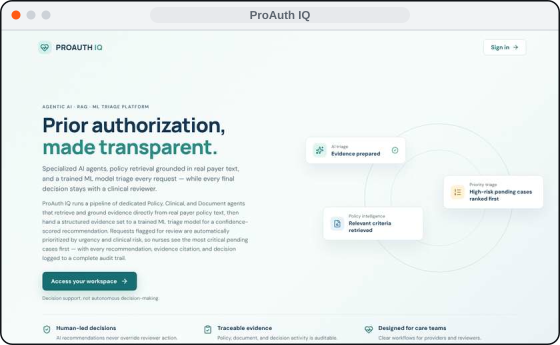</picture></a>

Teambull Fuel House (live) · Portfolio (3D Block City) · ProAuth IQ

<picture>
  <source media="(prefers-color-scheme: dark)" srcset="assets/h-skills-dark.svg">
  
</picture>

<picture>
  <source media="(prefers-color-scheme: dark)" srcset="assets/skills-dark.svg">
  
</picture>

<picture>
  <source media="(prefers-color-scheme: dark)" srcset="assets/h-journey-dark.svg">
  
</picture>

<picture>
  <source media="(prefers-color-scheme: dark)" srcset="assets/journey-dark.svg">
  
</picture>

<picture>
  <source media="(prefers-color-scheme: dark)" srcset="assets/h-certifications-dark.svg">
  
</picture>

<a href="https://jeankevin.vercel.app/#certifications"><picture><source media="(prefers-color-scheme: dark)" srcset="assets/certs-dark.svg"></picture></a>

Verify on Credly: [AWS Data Engineering](https://www.credly.com/go/tjGuJRVF) · [AWS Cloud Security Foundations](https://www.credly.com/go/IAEIfFO6) · Full list on my [portfolio](https://jeankevin.vercel.app/#certifications)
